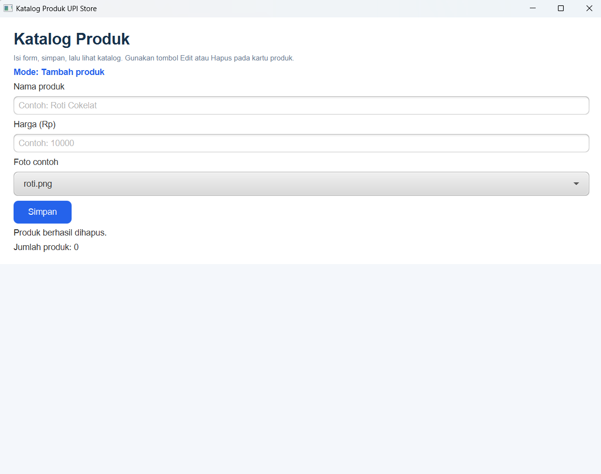
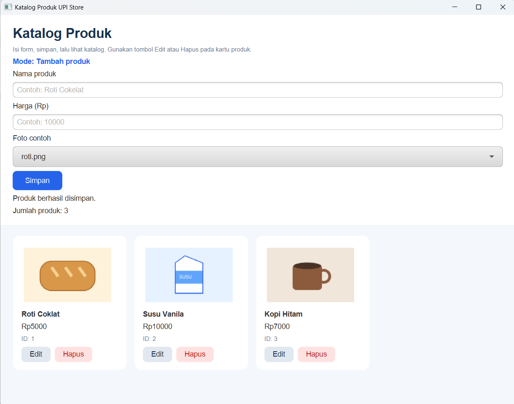
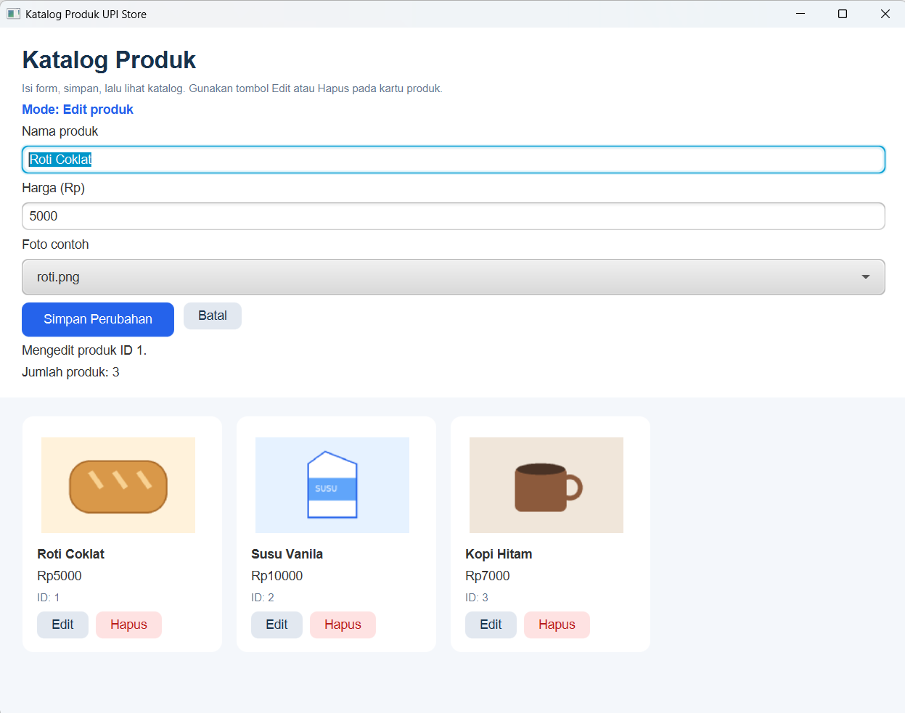
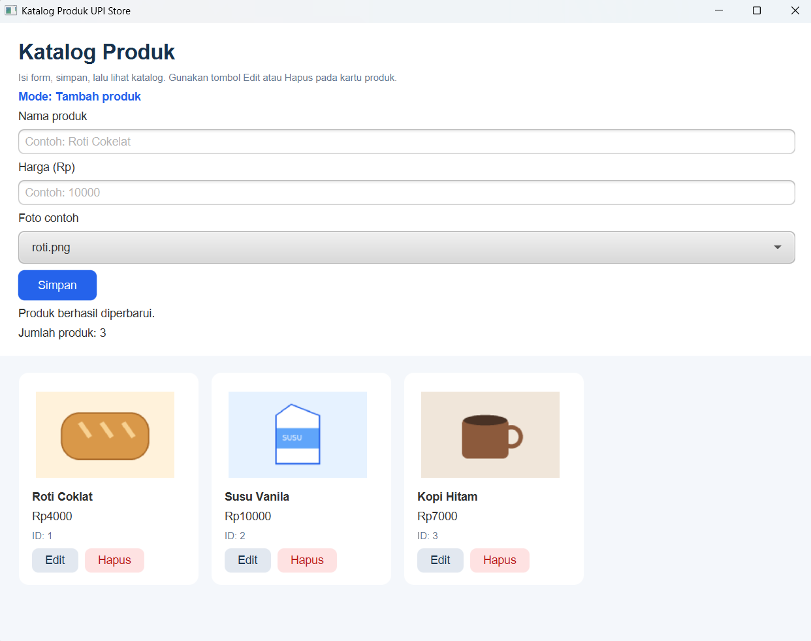
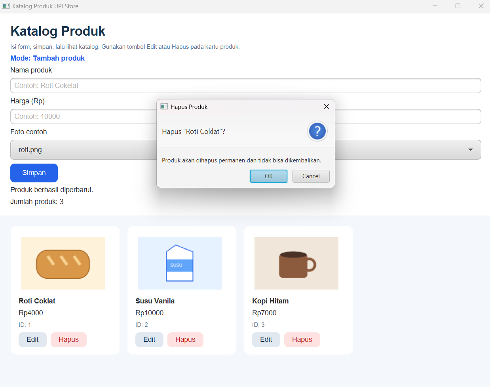
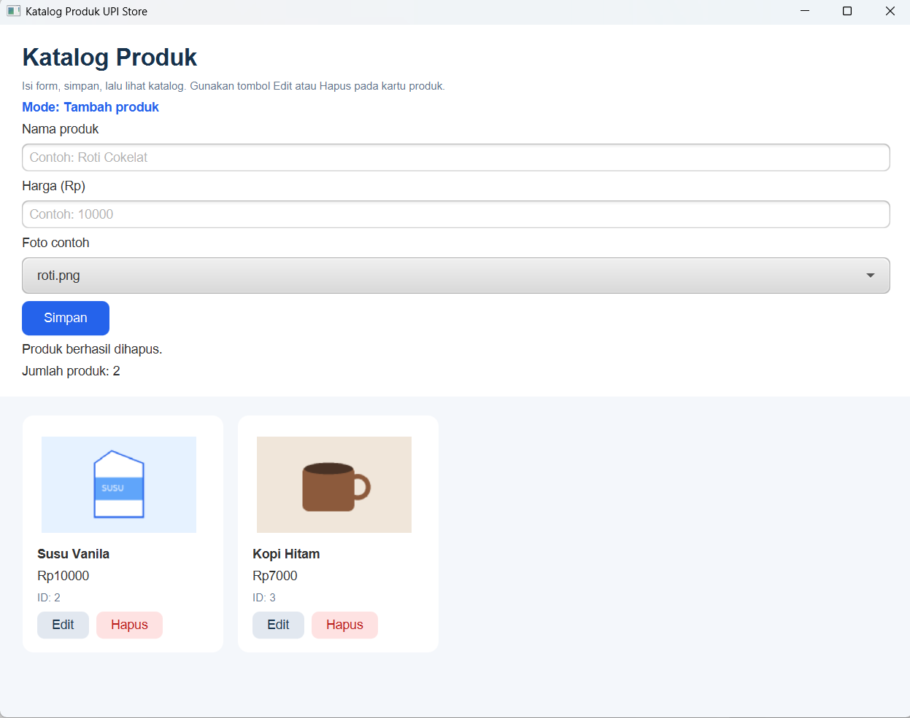

# Katalog Produk UPI Store

### Yuk, kelola produk toko dengan lebih mudah!

Katalog Produk UPI Store adalah aplikasi desktop sederhana yang membantu anda mengelola data produk toko. Melalui aplikasi ini, anda dapat menambahkan produk, melihat katalog produk, mengedit informasi produk, sampai menghapus produk yang sudah tidak diperlukan.

Aplikasi ini dibuat menggunakan **Java dan JavaFX** dengan tampilan yang simpel dan mudah digunakan. Data produk juga disimpan menggunakan database SQLite, sehingga data tetap tersedia meskipun aplikasi ditutup.

---

## Tampilan Aplikasi

### Halaman Form Tambah Produk

Halaman utama aplikasi yang berisi form untuk menambahkan produk.



### Halaman Katalog Produk

Halaman yang berisi katalog produk yang sudah tersimpan. Setiap produk ditampilkan dalam bentuk kartu yang berisi foto, nama, harga, dan ID produk.



### Form Edit Produk

Form akan terisi secara otomatis dengan informasi produk yang dipilih. Anda dapat mengubah nama, harga, atau foto produk, lalu menyimpan perubahan. Tersedia juga tombol **Batal** untuk membatalkan proses edit.

#### Sebelum Diedit



#### Setelah Diedit



### Konfirmasi Hapus Produk

Sebelum produk dihapus, aplikasi akan menampilkan dialog konfirmasi agar produk tidak terhapus secara tidak sengaja.

#### Sebelum Dihapus



#### Setelah Dihapus



---

## Fitur Aplikasi

- Menambahkan produk baru dengan mengisi nama dan harga.
- Memilih foto produk dari pilihan gambar yang tersedia.
- Menampilkan produk dalam bentuk kartu katalog.
- Menampilkan jumlah produk yang tersimpan.
- Mengedit informasi produk yang sudah ditambahkan.
- Menghapus produk dengan konfirmasi terlebih dahulu.
- Memvalidasi input nama dan harga produk.
- Menyimpan data produk secara permanen menggunakan database SQLite.

---

## Teknologi yang Digunakan

| Teknologi | Kegunaan |
|---|---|
| Java 17 | Bahasa pemrograman utama |
| JavaFX 21 | Membuat tampilan aplikasi |
| FXML | Mengatur layout aplikasi |
| CSS | Mengatur tampilan dan desain aplikasi |
| Maven | Mengelola dependency dan project |
| SQLite | Menyimpan data produk |
| SQLite JDBC | Menghubungkan aplikasi Java dengan database SQLite |

---

## Cara Menjalankan Aplikasi

### Persiapan

Pastikan laptop anda sudah memiliki:

- JDK 17
- Apache Maven
- NetBeans (opsional, jika ingin menjalankan melalui IDE)

JavaFX dan SQLite JDBC sudah didaftarkan sebagai dependency di dalam file `pom.xml`, sehingga Maven akan membantu menyiapkannya.

### Langkah-langkah melalui Terminal

**1. Ekstrak project**

Ekstrak file ZIP project `KatalogProduk` ke folder yang kamu inginkan.

**2. Masuk ke folder project**

Buka Terminal atau Command Prompt, lalu arahkan ke folder utama project yang berisi file `pom.xml`.

```bash
cd KatalogProduk
```

**3. Jalankan aplikasi**

Jalankan perintah berikut:

```bash
mvn clean javafx:run
```

**4. Aplikasi berhasil dijalankan**

Tunggu sampai proses build selesai. Jika berhasil, jendela **Katalog Produk UPI Store** akan terbuka.

### Menjalankan melalui NetBeans

1. Buka NetBeans.
2. Pilih **File → Open Project**.
3. Pilih folder project `KatalogProduk` yang berisi file `pom.xml`.
4. Tunggu sampai NetBeans selesai membaca project dan menyiapkan dependency Maven.
5. Klik kanan project **KatalogProduk**.
6. Pilih **Run** untuk menjalankan aplikasi.

---

## Penyimpanan Data

Aplikasi menggunakan SQLite sebagai database untuk menyimpan data produk.

File database berada di:

```text
data/katalog.db
```

Folder `data` dan tabel `produk` akan disiapkan secara otomatis ketika aplikasi pertama kali dijalankan. Data produk yang ditambahkan, diedit, atau dihapus akan langsung diperbarui di database.

**Catatan:** Jalankan aplikasi dari folder utama project (folder yang berisi `pom.xml`) agar file database tersimpan pada lokasi yang sesuai.

---

## Konsep Pemrograman yang Digunakan

Project ini dibuat sebagai bagian dari pembelajaran pemrograman Java. Beberapa konsep yang diterapkan antara lain:

- Object-Oriented Programming (OOP).
- Encapsulation.
- Pemisahan class berdasarkan tanggung jawabnya (Model, Controller, Repository, dan Database).
- Event handling pada JavaFX.
- Validasi input dan exception handling.
- Pengelolaan data menggunakan database SQLite.
- Penggunaan FXML dan CSS untuk membangun tampilan aplikasi.

---

## Pengembang

**Ofi Defiyanti**

Project Pemrograman Java | 2026

---

